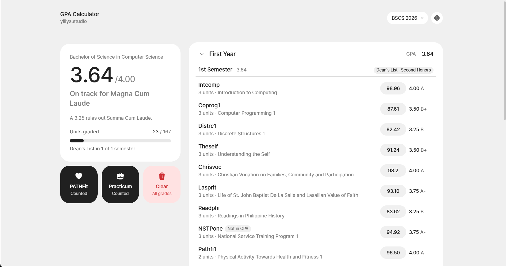

gpa.yiliya.studio
=================

A straightforward GPA calculator for De La Salle Lipa (DLSL) students

**[live site](https://gpa.yiliya.studio/)**



> **Supported curricula as of Nov. 2026:** BSCS 2026, BMMA 2026

Features
--------

- **Flexible grade input:** type the score you see in Canvas, a grade point, or a letter grade
- **Live GPA:** overall, per year and per semester
- **Honors tracking:** Dean's List per semester and Latin honors overall,
  following the DLSL handbook rules
- **PATHFit and Practicum toggles:** choose whether they count toward your GPA (cause idk if they do lol)


Stack
-----------

Built with [Next.js](https://nextjs.org/), [Tailwind CSS](http://tailwindcss.com/) and [Base UI](https://base-ui.com/)

### Development

Requires [Bun](https://bun.sh):

```sh
bun install
bun dev
```

## Adding a curriculum

1.   Create a data file in `src/data/` (see `dlsl-bscs-2026.ts` for the shape).
2. Register it in `CURRICULA` in `src/data/curricula.ts`.

The curriculum picker shows up automatically once there's more than one.
